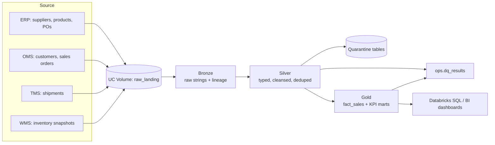

# Architecture & Design Decisions

## Decisions
| Decision | Rationale |
|---|---|
| Bronze stores all columns as strings | Ingestion never fails on bad types; typing is an explicit, testable Silver step |
| Quarantine instead of drop | Preserves audit trail and lets data owners fix upstream issues |
| Catalog name is a widget/bundle variable | Same code promotes dev -> prod without edits |
| Gold fact partitioned by `order_year` | Prunes scans for time-bounded dashboards; table is small so no further partitioning |
| DQ gate is the last job task and raises on errors | Failed run alerts the team; results persisted in Delta for trend monitoring |
| Overwrite loads in the demo | Keeps reruns idempotent; production variant (Auto Loader + MERGE) documented in notebook 01 |

## Orchestration
`setup -> bronze_ingestion -> silver_transformations -> gold_marts -> data_quality_checks` (see `resources/supply_chain_job.yml`).
